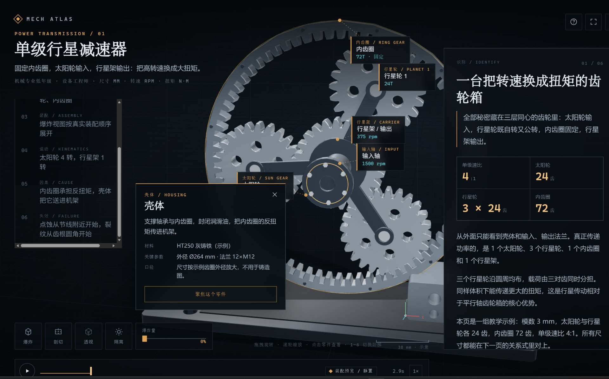
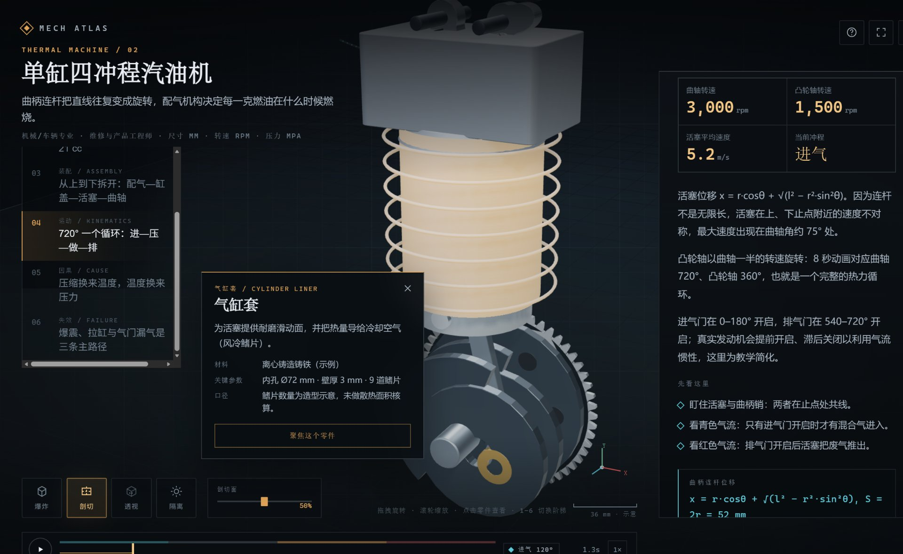
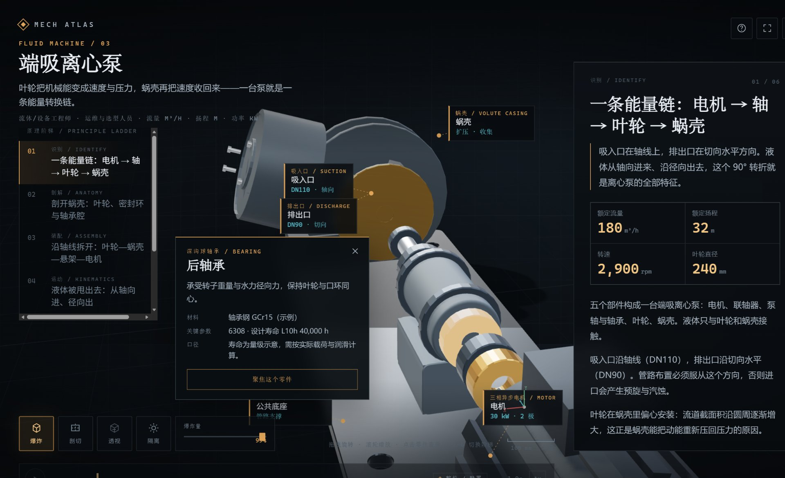
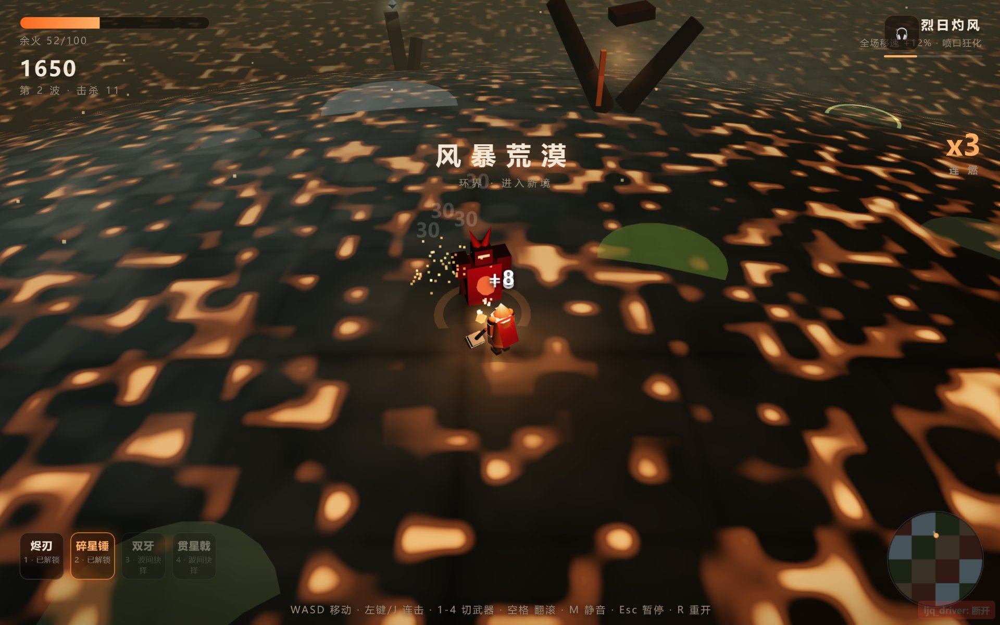
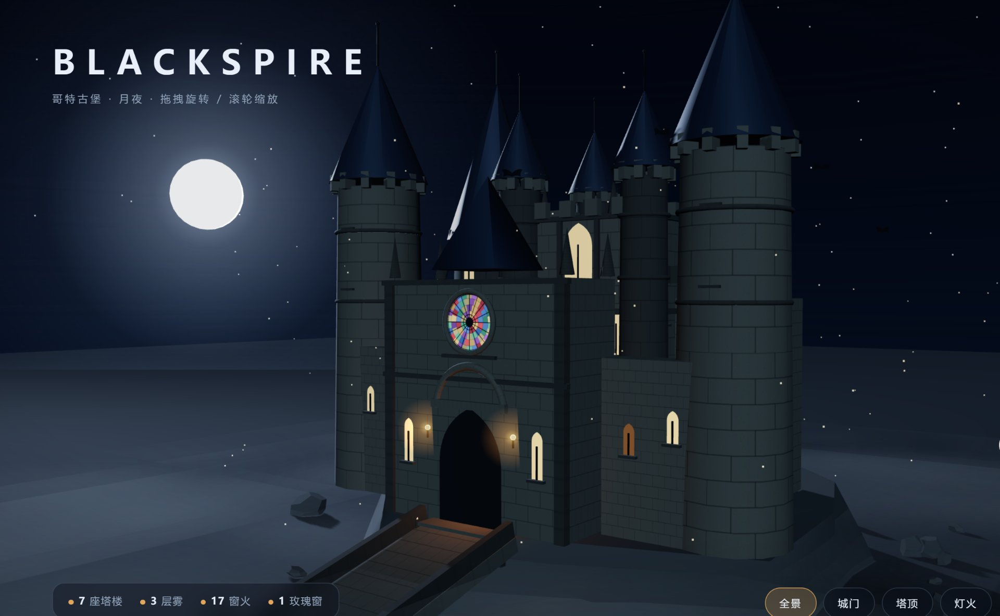
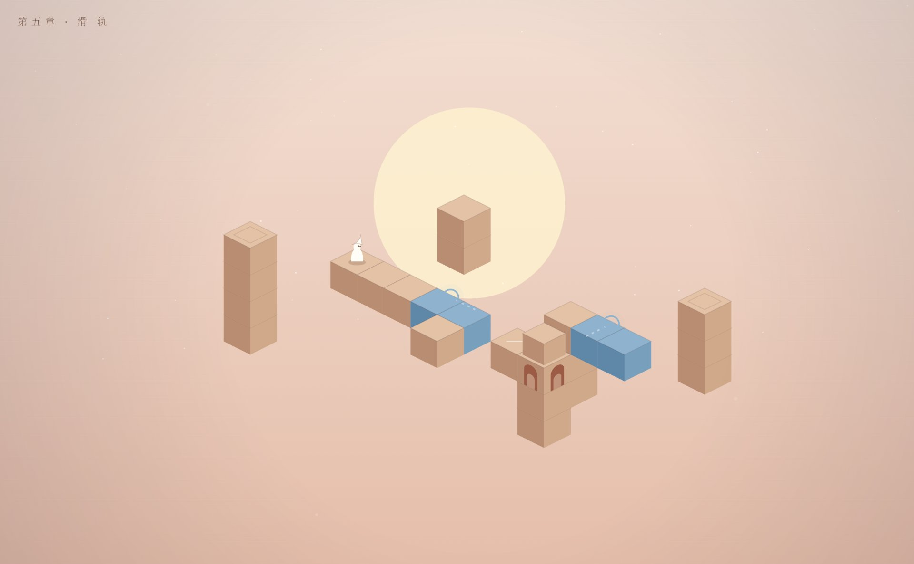
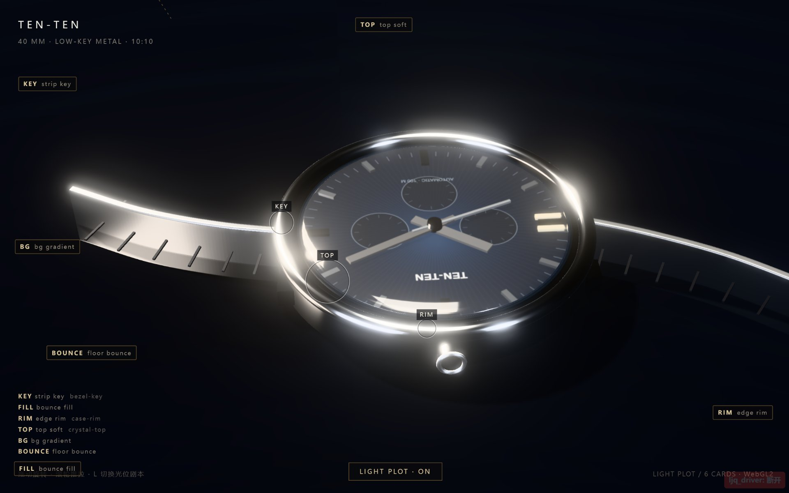
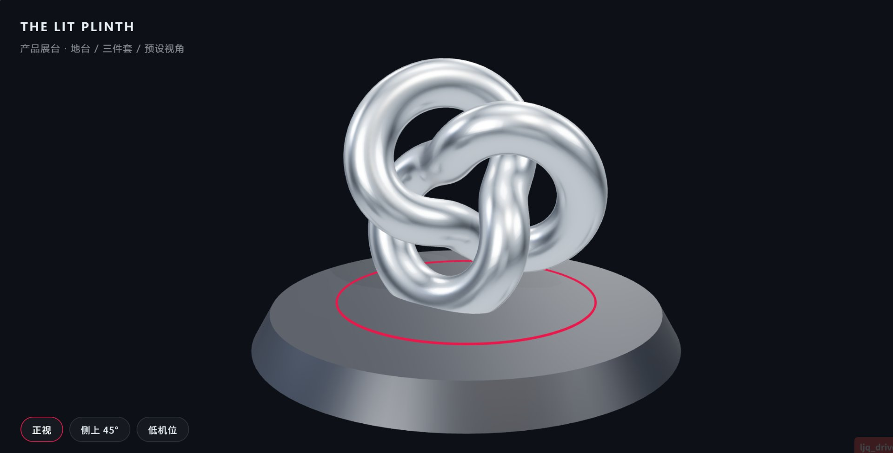

<div align="center">
  
</div>

<div align="center">

**Everything can become a skill.**
Forge any domain, task, or expert's craft into an Agent Skill that runs, verifies, and evolves.

*A meta-skill that forges any domain into a verifiable, evolvable Agent Skill.*

**[中文](README.md)** · English

[](https://github.com/pyf2818/pangu-create/releases)
[](LICENSE)
[](scripts)
[](#quick-start)
[](#scripts)

</div>

---

> Pangu parted the heavens, and all things took shape.
> This skill does one thing: package **how an expert thinks, works, and avoids pitfalls** into reproducible craft — not a longer prompt.

The skill body is written in Chinese (the working language it was forged in); this README gives English speakers the full picture. Frontmatter triggers include English aliases (`create a skill`, `make a skill`, `turn this into a skill`, `optimize my skill`, `score my skill`).

---

## The problem it solves

Most skill creators optimize for "is the document complete". What actually decides success is **the artifact**. pangu-create sets a gate for each common failure:

| Common failure | Symptom | Countermeasure |
|---|---|---|
| **Prompt pile** | Long SKILL.md, agent still freelances | Workflow layer: steps + I/O + checkpoints + failure branches |
| **Doc-only quality** | High rubric score, mediocre output | Output quality gates: references → craft parameters → blind comparison |
| **Self-graded work** | "Looks fine to me" as evidence | Independent judge blind review; authors cannot self-certify |
| **Ship once** | Delivery is the end; lessons never flow back | Born-evolving: `results.tsv` ledger + paired ratchet + harvest loop |
| **No baseline** | Claims "better" without seeing the without-skill behavior | Test prompts first; run the baseline before claiming improvement |

In one line: **a document score is not an artifact score; doc compliance is not release-grade.**

## Core claim

> **A top-tier skill = a non-obvious design thesis + an original example set + a verifiable production line.**

1. **Design thesis (North Star)** — not "faster / more professional / more complete" (any competitor can say that), but a judgment that survives the **competition test**: if a rival skill could say the same sentence, the thesis belongs to the category, not to you.
2. **Original examples** — ≥3 openable/runnable examples covering distinct patterns, plus 1 hand-finished signature work. Screenshots are evidence, not works.
3. **Deterministic production line** — core generation and validation live in `scripts/` with one-command `verify` / `finalize`. No drift across models; reproducible across people.

These are written into `references/design-thesis.md` at project kickoff and enforced by `scripts/verify_skill.py` — not by model discipline.

## Two pipelines

- **Forge** (create from zero): Phase 0 intent triage → Stage 1 understand & define (brief, five implicit questions, test prompts, baseline) → F1 sibling recon + multi-source research → F2 kernel distillation (iron laws / mental models / taste) → F3 build with factory gates → F4 independent testing (baseline compare, critic round, red team, blind review) → F5 first evolution pass.
- **Evolve** (sharpen an existing skill): E0 authorization + tree-state check (snapshot by default; no branch/commit unless explicitly authorized) → E1 11-dimension baseline → E2 single-dimension change per round with 3-judge **paired majority vote** (keep/revert) → E3 report → E4 signature-work harvest → E5 metabolism (pangu evolves itself).
- **Read-only audit vs mutation**: "score/check/diagnose" is zero-write, zero-network, zero-ledger; "optimize/upgrade" may edit the target skill and take snapshots; commit/push/publish requires an explicit user command. On a shared dirty worktree, pangu never stashes, resets, or switches branches.
- **Born evolving**: every forged skill must pass one full evolution pass before delivery. Unverified skills don't ship.

## Quick start

Requirements: Python 3.9+ (stdlib only, zero third-party deps); any agent runtime that reads `SKILL.md`.

```bash
git clone https://github.com/pyf2818/pangu-create.git

# Install into your skills directory (pick per runtime)
cp -r pangu-create ~/.agents/skills/       # generic
cp -r pangu-create ~/.claude/skills/       # Claude Code
cp -r pangu-create ~/.trae-cn/skills/      # TRAE
```

Install self-check:

```bash
python pangu-create/scripts/quality_check.py pangu-create/SKILL.md   # 11/11 structural only
python pangu-create/scripts/rubric_score.py pangu-create/SKILL.md    # auto max 75; dims 8 (19 pts) and 10 (6 pts) are human-only
```

Then just tell your agent (Chinese or English):

```
盘古开天，帮我做一个把长文自动拆成短视频分镜的 skill
"pangu create, make me a skill that turns long articles into short-video storyboards"
```

In interactive mode every 🔴 CHECKPOINT is a blocking gate: stage results first, then 2-4 concrete questions, and it waits for your answer. Say "run to the end without asking" and every default decision gets logged to `results.tsv`. Read-only requests ("score it", "health check") never write files, create branches, or access the network.

## What one sentence produces

Results first, theory later. Everything below was generated by **skills forged with pangu-create** (`mech-atlas` / `threejs-web` / `web-game-craft`), each from a single natural-language sentence — no hand-written code, no frame-by-frame tuning.

**🔧 3D mechanical teardowns · mech-atlas** (HUD style · clickable parts · kinematics animation)

| Planetary gearbox | 4-stroke engine | End-suction centrifugal pump |
|---|---|---|
|  |  |  |

**🎮 3D scenes & games**

| Storm Desert · 3D roguelite | BLACKSPIRE · gothic castle | Ch.5 · Monument-style puzzle |
|---|---|---|
|  |  |  |

**✨ Product-grade WebGL lighting**

| TEN-TEN · watch light plot | THE LIT PLINTH · product stage |
|---|---|
|  |  |

One sentence in, a runnable, interactive, publishable work out. That is what "everything can become a skill" means.

## What gets delivered

```
my-skill/
├── SKILL.md                   # agent entry: triggers + workflow + iron laws + failure branches
├── README.md                  # human entry: 3-step start + examples + comparison + limits
├── references/
│   ├── design-thesis.md       # thesis + competition test + 8-12 subject-unique materials
│   ├── promise-table.md       # promise / assertion / test ID / evidence pointer
│   ├── kernel.md              # iron laws / mental models / taste
│   └── research/              # recon archives (absorption table, gap map, sources)
├── examples/                  # ≥3 openable/runnable examples
├── assets/showcase/           # 1 hand-written signature work
├── scripts/                   # deterministic core: verify / finalize / check
├── tests/verification.json    # behavior + failure-injection manifest (no shell strings)
├── evidence/verification.json # fresh receipt generated by --execute (source+manifest hashed)
├── test-prompts.json          # happy_path / complex / failure test prompts
└── results.tsv                # evolution ledger (10 cols incl. evidence)
```

`verify_skill.py <dir> --type output --execute` runs the manifest and writes a hash-bound receipt; `--check` re-validates it without running anything. Structural gates check thesis, examples, signature work, promise→test-ID binding, injection categories — any miss is `exit 1`. The default structural mode is preflight, not release certification.

## Quality system

- **Three-layer kernel**: iron laws (violating them causes incidents) / workflow (reproducible steps) / taste (top-1% judgment, AI-cliché blacklist).
- **Eight quality dimensions**: function, stability, performance, aesthetics, safety, evolvability, portability, cost — load-bearing dimensions are chosen at kickoff, inherited from siblings at recon, covered at build, verified by matrix at test.
- **11-dimension rubric** (100 pts): dims 1-7/9/11 auto-scored (max **75**); dim 8 "real performance" (19 pts) and dim 10 "taste" (6 pts) are human-only. Typed scoring since v1.2.0: `--type output|text` — a meta/text skill is judged on its evolution trio instead of an example corpus (its examples *are* the downstream skills it forges).
- **Output quality gates** (artifact-producing skills): ① reference gate (deconstruct 2-3 top-tier finished works to parameter level) ② craft gate (≥8 quantified parameters + ≥2 signature moves) ③ blind-compare gate (independent judges, sources hidden; losing to the reference = soft fail).
- **Executable delivery gates**: promise→test-ID matrix, `tests/verification.json`, hash-bound fresh receipt (`--execute`), fault injection (fail loudly, never silent white screen), exit codes 0/1/2 separating product defects from environment noise, thresholds with a single ≥1.5× measurement or 3-sample median **and** minimum at the threshold.

## Scripts

Zero dependencies, Python 3.9+, `--json` for CI.

| Script | Purpose |
|---|---|
| `scaffold.py` | generate target skill skeleton (with a deliberately failing placeholder test + manifest) |
| `quality_check.py` | 11-item structural self-check |
| `rubric_score.py` | 11-dimension auto scoring (max 75; dims 8/10 human-only) |
| `verify_skill.py` | structural preflight / behavior execution / receipt validation (`--execute` / `--check`) |
| `analyze_evolution.py` | evolution trends + data-quality warnings from `results.tsv` |

## Evolution loop

Delivery is generation 0. Every real use writes a ledger row. keep/revert trusts only **paired same-judge comparison with odd-majority vote** (absolute LLM scores are samples, not measurements — ±8 noise); one dimension per round; two consecutive `worse` on the same problem escalates to rewrite; successful works are harvested back into recipes and the shared knowledge base. Depth levels: L1 framework → L2 engineering → L3 expert.

## Forged with this skill

| Case | Type | Result |
|---|---|---|
| `threejs-web` | 3D web pages | thesis "The Lit Plinth"; old auto score 81/81 (retired scale) while the artifact was still judged "average" — kept as the counterexample |
| `knowledge-cards` | knowledge cards | node-link architecture-diagram form; historical structural/injection/offline evidence |
| `photoreal-product` | studio-grade product pages | historical blind review 6/7 vs plain three.js control |
| `html-to-video` | HTML→video | post-evolution clearly better than v1; ffprobe duration/fps measurements |
| `novel-writing` | long-form novels | state routing + continuity ledger + hook library |
| `web-game-craft` | pixel games | real incidents fed back as iron laws |

> These cases predate the v1.3 manifest + fresh-receipt mechanism; historical records are not current certification. See [evidence/verification.json](evidence/verification.json) for pangu's own fresh receipt; other skills need individual migration before re-validation.

## Known limits

- Auto rubric covers structural dimensions only (max 75); dims 8 and 10 need humans
- Hash binding proves the receipt matches this source/manifest and passed then — not that assertions cover every real intent
- Read-only audit is not release certification: no ledger, branch, or file writes
- Blind review is still model judgment — not a substitute for real user research
- Market-heat scan is a heuristic, not market data
- Trend analysis depends on `results.tsv` data quality; the parser warns about missing headers/short rows/absent full_test
- Rare domains (<5 reliable sources) yield framework-level skills, honestly labeled
- Trigger reliability is bounded by the runtime's skill discovery
- Historical examples under `skills/` are not all migrated to the v1.3 receipt mechanism

## License

[MIT](LICENSE) © 2026 pyf2818

---

<div align="center">
<sub>Pangu parted the heavens, and all things took shape.<br/>A skill is not a prompt snippet — it is an expert's thinking, practice, and pitfalls, packaged as reproducible craft.</sub>
</div>
