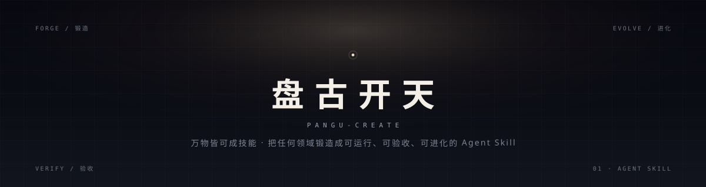
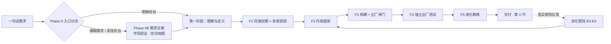

<div align="center">
  
</div>

<div align="center">

**万物皆可成技能。**
把任何领域、任何任务、任何专家经验，锻造成能运行、能验收、能进化的 Agent Skill。

*A meta-skill that forges any domain into a verifiable, evolvable Agent Skill.*

[](https://github.com/pyf2818/pangu-create/releases)
[](LICENSE)
[](scripts)
[](#快速开始)
[](#脚本)

[快速开始](#快速开始) · [怎么用](#怎么用) · [质量体系](#质量体系) · [进化循环](#进化循环) · [FAQ](#faq) · [已知局限](#已知局限)

</div>

---

> 盘古开天，万物始生。
> 这个 skill 只做一件事：把「专家怎么思考、怎么做事、怎么避坑」封装成可复现的工艺——而不是一段更长的提示词。

---

## 目录

- [它解决什么问题](#它解决什么问题)
- [核心主张](#核心主张)
- [两条管线](#两条管线)
- [快速开始](#快速开始)
- [怎么用](#怎么用)
- [交付物长什么样](#交付物长什么样)
- [质量体系](#质量体系)
- [脚本](#脚本)
- [进化循环](#进化循环)
- [仓库结构](#仓库结构)
- [设计哲学](#设计哲学)
- [与同类项目的关系](#与同类项目的关系)
- [已锻造案例](#已锻造案例)
- [FAQ](#faq)
- [已知局限](#已知局限)
- [贡献](#贡献)
- [致谢](#致谢)
- [License](#license)

---

## 它解决什么问题

市面上的 skill 创建器大多在解决「文档写得够不够全」，但真正决定成败的是**产物**。盘古开天针对五种常见失败逐一设卡：

| 常见失败 | 具体表现 | 盘古开天的对策 |
|---|---|---|
| **堆提示词** | SKILL.md 很长，AI 每次仍自由发挥 | 工作流层：步骤 + 输入输出 + 检查点 + 失败分支 |
| **只写文档** | rubric 高分，成品观感平庸 | 产出质量三关：参照物 → 工艺参数 → 盲评对比 |
| **自评自证** | 「我看了没问题」当作证据 | 独立 judge 盲评，作者不得自证 |
| **一次成型** | 交付即终点，问题不回流 | 出生即进化：`results.tsv` + paired 棘轮 + E4 回流 |
| **没有基线** | 声称「更好」，却没见过不带 skill 的样子 | 测试题先行，先跑 baseline 再谈改进 |

一句话：**文本分不等于作品分，文档合规不等于发布级。**

---

## 核心主张

> **顶级 skill = 一个非显然的设计论点 + 一套独创范例 + 一条可验证的生产线。**

三者缺一不可：

1. **设计论点（North Star）**
   不是「更高效 / 更专业 / 更全面」这种品类通稿，而是能通过**竞争测试**的具体判断：把同类主体代入后，论点仍然成立 → 它属于品类，不是你的。
   例：「3D 的失败不是不够炫，而是悬浮虚空里的塑料感与静默黑屏——先落地（接影 / 同色雾 / 非默认构图 / 三件套打光），特效只做加法。」

2. **独创范例**
   ≥3 件可打开 / 可运行的范例，覆盖不同模式；外加 1 件**手写署名作品**。截图是证据，不是作品；模板直出不算。

3. **确定性生产线**
   核心生成与校验落进 `scripts/`，一键 `verify` / `finalize`。换模型不漂移，换人也能复现。

这三样东西在立项阶段就写入 `references/design-thesis.md`，由可执行闸门 `scripts/verify_skill.py` 卡住——不是靠模型自觉。

---

## 两条管线



**锻造（Forge）**：从零创建。第一阶段先想清楚（意图显影 → 七要素简报 → 隐性五问 → MVP/增强项），再侦察学习，沿 F1-F5 往下走。

**进化（Evolve）**：把已有 skill 磨强。E0 建分支与账本 → E0.5 测试题 → E1 基线 → E2 单维改动 + 3 judge paired 多数决 → E3 报告 → E4 代表作回流。

**出生即进化**：锻造出的 skill 在交付前必须完整走一轮进化精炼，未经实战检验的 skill 不许出厂。

---

## 快速开始

**要求**：Python 3.9+（脚本只用标准库，无第三方依赖）；任何能读取 `SKILL.md` 的 Agent 运行时。

```bash
git clone https://github.com/pyf2818/pangu-create.git

# 安装到你的 skills 目录（按运行时任选）
cp -r pangu-create ~/.agents/skills/       # 通用
cp -r pangu-create ~/.claude/skills/       # Claude Code
cp -r pangu-create ~/.trae-cn/skills/      # TRAE
```

项目级安装：把 `pangu-create/` 放进 `<project>/.agents/skills/`。

**安装自检**：

```bash
python pangu-create/scripts/quality_check.py pangu-create/SKILL.md
# 结果: 11/11 通过

python pangu-create/scripts/rubric_score.py pangu-create/SKILL.md
# 文档结构分 76/81（不含维度 8「实测表现」的 19 分，需人工跑测试题）
```

安装完成后，直接对 Agent 说：

```
盘古开天，帮我做一个把长文自动拆成短视频分镜的 skill
```

或使用任意旧触发词：「造skill」「创建skill」「把XX做成skill」「蒸馏成skill」「优化skill」「给skill打分」「skill体检」。

---

## 怎么用

| 你说 | 发生什么 |
|---|---|
| 「盘古开天，做个 XX 的 skill」 | 锻造管线：立项（定位 + 档位 + 测试题 + 基线）→ 同类侦察 → 内核提炼 → 构建 → 出厂测试 → 进化精炼 |
| 「把我们刚才这个过程做成 skill」 | 锻造·快速蒸馏：参照物信息密度高时跳过同类侦察，直接从脚本 / 对话 / 文档提炼内核（不省验证） |
| 「我想要一个能提升 XX 的技能」 | 需求诊断：先扫描已装 skill，最多追问 2 轮，给出 ≤3 个候选 |
| 「我觉得 XX 领域缺一个 skill」 | 市场验证 + 空白地图：4 指标热度扫描 → 覆盖图 → 让你选成熟方向或创新方向 |
| 「优化这个 skill」 / 「给它打分」 | 进化管线：11 维基线 → 单维改进 + paired 多数决棘轮 → 触顶收工 |
| 「skill 体检」 | 只跑静态自检 + rubric 评分，不改文件 |

交互模式下，每个 🔴 CHECKPOINT 都是**阻塞闸门**：先展示阶段成果，再给 2-4 个具体选择题，等你回应才继续。你可以随时说「自动跑完别问」，此时所有默认决策会逐条记入 `results.tsv`。

---

## 交付物长什么样

一个经盘古开天锻造出的产出型 skill：

```
my-skill/
├── SKILL.md                      # AI 执行入口：触发条件 + 工作流 + 铁律 + 失败分支
├── README.md                     # 人类入口：3 步上手 + 示例 + 同类对比 + 局限
├── references/
│   ├── design-thesis.md           # 设计论点 + 竞争测试 + 8-12 条独有素材
│   ├── kernel.md                 # 铁律层 / 模型层 / 品味层
│   ├── art-direction.md          # 产出型：从顶级成品拆出的参数级标杆
│   ├── parameter-cards.md        # 产出型：≥8 项可量化工艺参数
│   ├── failure-branches.md       # 失败分支与降级路径
│   └── research/                 # 调研存档（同类吸收表 / 空白地图 / 证据）
├── examples/                     # ≥3 件可打开 / 可运行的范例
├── assets/showcase/              # 1 件手写署名作品
├── scripts/                      # 确定性核心：verify / finalize / check
├── test-prompts.json             # happy_path / complex / failure 三类测试题
└── results.tsv                   # 进化账本（9 列）
```

交付前，`scripts/verify_skill.py <dir> --type output` 会检查：论点档案、范例数量、署名作品、一键验收脚本。任一缺失直接 `exit 1`，不许进入 F4/F5。

---

## 质量体系

### 三层内核

| 层 | 是什么 | 没有它会怎样 |
|---|---|---|
| **铁律层** | 违反必出事故的正确性规则 | AI 在压力下静默跑偏，产出看似可用实则埋雷 |
| **工作流层** | 步骤、输入输出、检查点、失败分支 | 每次执行结果不可复现 |
| **品味层** | 前 1% 从业者的判断力、俗手清单、反模式 | 产出永远是「通用的 80 分」 |

### 八维质量模型

功能 / 稳定性 / 性能 / 观感 / 安全 / 可进化 / 兼容 / 成本。
立项即选「负重维度」，侦察时逐维继承同类最强解法，构建时逐维覆盖，测试时跑验证矩阵。

### 11 维 rubric

文档结构 100 分：1-7、9-11 可脚本自动算（81 分），维度 8「实测表现」19 分必须人工跑测试题。自动评分高 ≠ 真的好用。

```bash
python scripts/rubric_score.py my-skill/SKILL.md
```

### 产出质量三关

| 关 | 动作 | 失败条件 |
|---|---|---|
| **1 · 参照物** | 拆 2-3 个该领域顶级**成品**到参数层，写入 `art-direction.md` | 拿同类 skill 的默认模板当标杆 |
| **2 · 工艺参数** | 把品味翻成 ≥8 项可量化参数（色板 hex / 字阶 / 间距 / 光比 / 缓动 / 时长…）+ ≥2 个非默认招牌手法 | 用「加了粒子 / 辉光」冒充质量 |
| **3 · 盲评对比** | 不知来源的独立 judge 与参照物并排，判「哪件更像可发布作品」 | 作者目检、同上下文自评 |

产出型 skill 还须过**一票否决项**（如产品必须落地、高光可指认）与**反模板测试**（与默认模板并排，指不出 ≥3 处实质差异 = 模板换皮）。

### 检查点与红队

- 交互模式下 CHECKPOINT 被跳过 = **硬性失败**，回到检查点重来
- 产出型出厂必过独立批评家 roast 与红队轮（绕检查点 / 极端输入 / 滥用 / 越界）
- 观感验收分**及格线**（锚点打勾）与**惊喜线**（≥2 个进阶配方）——「及格但平庸」不许出厂

### 可执行闸门

```bash
python scripts/verify_skill.py my-skill --type output
# PASS 设计论点 / 范例集 / 署名作品 / 确定性核心 —— 任一 FAIL 即 exit 1
```

---

## 脚本

全部零第三方依赖，Python 3.9+。

| 脚本 | 用途 | 用法 |
|---|---|---|
| `scaffold.py` | 生成目标 skill 骨架 + 立项检查单 | `python scripts/scaffold.py my-skill --name my-skill` |
| `quality_check.py` | 静态 11 项自检（frontmatter / 失败分支 / 检查点 / 软化措辞 / 自包含…） | `python scripts/quality_check.py my-skill/SKILL.md` |
| `rubric_score.py` | 11 维 rubric 自动评分（维度 1-7/9-11） | `python scripts/rubric_score.py my-skill/SKILL.md` |
| `verify_skill.py` | 产出型出厂闸门（论点 / 范例 / 署名作品 / 确定性核心） | `python scripts/verify_skill.py my-skill --type output` |
| `analyze_evolution.py` | 进化趋势（worse 分布 / 高频维度 / 改进建议） | `python scripts/analyze_evolution.py my-skill/results.tsv` |

`--json` 可用于 CI 或自动化流水线。

---

## 进化循环

交付只是第 0 代。每次真实使用都产生一条记录：

```
timestamp        commit  skill  old_score  new_score  status  dimension  note  eval_mode
2026-10-21T10:00 -       my-skill  4/7      6/7      keep    观感      光比与接触锚点修复  independent-blind-ab
```

- **keep / revert 只信 paired 多数决**：同一 judge 同次读两版比较，3 个 judge 奇数投票；绝对分只做 triage
- **每轮只改一个维度**：多变量同时改，涨跌无法归因
- **两次 worse 升级重写**：同一问题连续两次被判 worse，不再打补丁，从头重写
- **E4 代表作回流**：用 → 收（入 showcase）→ 拆（新配方 / 新踩坑）→ 回填（references / `research/shared/`）
- **深度等级**：L1 框架级 → L2 工程级 → L3 专家级，随真实案例晋升

```bash
python scripts/analyze_evolution.py my-skill/results.tsv
```

---

## 仓库结构

```
pangu-create/
├── SKILL.md                    # 主编排：入口分流、双管线、检查点、12 条铁律、23 条反模式
├── README.md                   # 你正在读的文件
├── assets/banner.svg           # 视觉标识
├── references/
│   ├── forge.md                # 锻造管线详解（调研 / 内核提炼 / 构建 / 出厂测试 / 精炼）
│   ├── evolve.md               # 进化管线详解（进化契约 / paired 协议 / results.tsv 格式）
│   ├── rubric.md               # 11 维评分标准 + 运行时中立门禁
│   ├── playbooks.md            # 领域手法库（预组合 + 产出形态 × 知识类型两轴）
│   ├── quality-dimensions.md   # 八维质量模型与各阶段落地动作
│   ├── output-quality.md       # 产出质量三关 + 变体与迭代纪律
│   ├── top-tier-patterns.md    # 四个头部 skill 拆解 + 六条可迁移机制
│   ├── testing.md              # 测试方法论（基线对照 / 独立评审 / paired / 压力测试）
│   ├── templates.md            # 产物模板库
│   └── failure-modes.md        # 失败模式与降级表
├── scripts/                    # 5 个零依赖 Python 工具
└── research/shared/            # 跨 skill 共享知识层
    ├── iron-rules.md           # 通用铁律
    ├── anti-patterns.md        # 通用反模式
    ├── taste-signals.md        # 品味信号
    ├── incoming.md             # 待吸收清单
    └── evolution-feedback.md   # 使用回流
```

---

## 设计哲学

以下规则对本 skill 自身同样生效：

1. **没有基线就没有发言权** —— 没看过「不带 skill 会怎样」，就没资格说「带了更好」
2. **没有失败分支的 skill 不是 skill** —— 只写正向流程，等于把事故留给运行时的 AI
3. **keep/revert 只信 paired 多数决** —— 绝对分是抽样，不是测量
4. **每轮只改一个维度** —— 否则涨跌无法归因
5. **60 分诚实 > 90 分编造** —— 宁可标注局限，不交付看似完美的虚构
6. **自包含，复制即用** —— 调研、脚本、参考全部在 skill 目录内
7. **运行时中立** —— 不硬编码单一 runtime 的路径与工具名
8. **产出质量不能自证** —— 作者目检不构成证据，独立盲评才算
9. **没有论点与署名作品，只是模板** —— 文档分再高也不豁免

---

## 与同类项目的关系

盘古开天站在四条成熟路线之上，并补上它们各自的缺口：

| 项目 | 核心贡献 | 盘古开天的关系 |
|---|---|---|
| [alchaincyf/nuwa-skill](https://github.com/alchaincyf/nuwa-skill) | 多源调研 + 内核提炼 + 独立验证 | 吸收为锻造管线的基底 |
| [alchaincyf/darwin-skill](https://github.com/alchaincyf/darwin-skill) | 10 维 rubric + paired 棘轮进化 | 扩展为 11 维，并补上真实基线与自评估禁令 |
| [obra/superpowers](https://github.com/obra/superpowers) | 文档 TDD 与反合理化方法论 | 吸收「测试题先行」与反借口话术 |
| [fattly/god-skill](https://github.com/fattly/god-skill) | 人物蒸馏、矛盾仲裁、硬性/软性失败分级 | 吸收三层 Agent 编排与失败分级 |
| **pangu-create** | 双管线闭环 + 产出质量三关 + 设计论点/范例/署名作品 + 可执行闸门 | 把「文档合规」推进到「作品可验收」 |

---

## 已锻造案例

以下 skill 均由本技能在同一工作区中锻造并走完 F4/F5（不包含在本仓库内）：

| 案例 | 类型 | 结果 |
|---|---|---|
| `threejs-web` | 3D 网页 | rubric 81/81；设计论点「The Lit Plinth（有光的地台）」 |
| `knowledge-cards` | 知识卡片 | rubric 78.6/81；节点-连线架构图形态 |
| `photoreal-product` | 棚拍级产品页 | 独立盲评 6/7，高于普通 three.js 对照页 |
| `html-to-video` | HTML 转视频 | 进化后观感显著优于初版 |
| `novel-writing` | 长篇小说 | 状态路由 + 连续性账本 + 三层钩子库 |
| `web-game-craft` | 像素游戏 | 真实事故回流为铁律（语法自检 / dt 量纲） |

---

## FAQ

**Q：需要联网吗？**
运行时不需要。脚本零依赖；F1 同类侦察与多源调研阶段需要联网检索，离线时可切纯本地语料模式。

**Q：支持哪些 Agent 运行时？**
任何读取 `SKILL.md` 的运行时：Claude Code、TRAE、Cursor、自建 agent 等。本 skill 遵守运行时中立（铁律 8）。

**Q：和「直接写一段提示词」有什么区别？**
提示词描述目标；skill 封装工艺。区别在于检查点、失败分支、可量化参数、独立验收与进化账本——这些才是让产出可复现的部分。

**Q：会消耗很多 token 吗？**
开跑前会报档位：快速（约标准档 1/3）/ 标准 / 精品。长任务按 Phase 落盘，可分段续跑。

**Q：生成物一定要有 Python 脚本吗？**
产出型 skill 必须有「确定性核心」（一键 verify / finalize）；纯文本型 skill 可只交付骨架与测试题，闸门会按 `--type text` 降级。

**Q：中文还是英文？**
本体是中文，frontmatter 与触发词包含英文别名；产出的 skill 语言跟随用户与领域素材。

---

## 已知局限

诚实边界（完整版见 [SKILL.md](SKILL.md)「诚实边界」）：

- **rubric 自动分只覆盖文档结构**（81/100），维度 8「实测表现」必须人工跑测试题
- **盲评仍是模型判断**，不能替代真实用户研究；重要决策保留人审
- **市场热度扫描是启发式**，4 指标不等于真实市场数据
- **趋势分析依赖 `results.tsv` 数据质量**，记录不完整会误导判断
- **冷门领域**（可靠来源 <5 条）只能产出框架级 skill，交付时会标注薄弱维度
- **找不到顶级参照物时**，产出质量第一关只能降级，成品上限随之降低
- **触发可靠性受运行时 skill 发现机制影响**，description 迭代只能提高概率
- **蒸馏真人思维或私有流程**时，素材合法性与授权由用户负责

---

## 贡献

欢迎 PR，但请遵守本仓库自己的规矩：

1. **一次只改一个维度**，并在描述里附上与改动前的直接对比
2. **不要只改措辞**——措辞调整不算改进，除非附评分或测试证据
3. **新失败模式**请同时更新 `research/shared/` 对应条目与 `results.tsv`
4. **新增脚本**必须零第三方依赖、可离线运行、带 `--help`
5. 提交前跑一遍：

```bash
python scripts/quality_check.py SKILL.md
python scripts/rubric_score.py SKILL.md
```

---

## 致谢

- [alchaincyf/nuwa-skill](https://github.com/alchaincyf/nuwa-skill) 与 [alchaincyf/darwin-skill](https://github.com/alchaincyf/darwin-skill)——创建与进化的基底
- [anthropics/skills](https://github.com/anthropics/skills)、[obra/superpowers](https://github.com/obra/superpowers)——官方实践与文档 TDD
- [fattly/god-skill](https://github.com/fattly/god-skill)——人物蒸馏、矛盾仲裁、失败分级
- [heygen-com/hyperframes](https://github.com/heygen-com/hyperframes)、[browser-use/video-use](https://github.com/browser-use/video-use)——视频管线参考
- 以及所有被拆解、被吸收、被反着用的头部 skill 作者

---

## License

[MIT](LICENSE) © 2026 pyf2818

---

<div align="center">
<sub>盘古开天，万物始生。<br/>Skill 不是提示词片段，是把专家的思考、做法与避坑封装成可复现的工艺。</sub>
</div>
